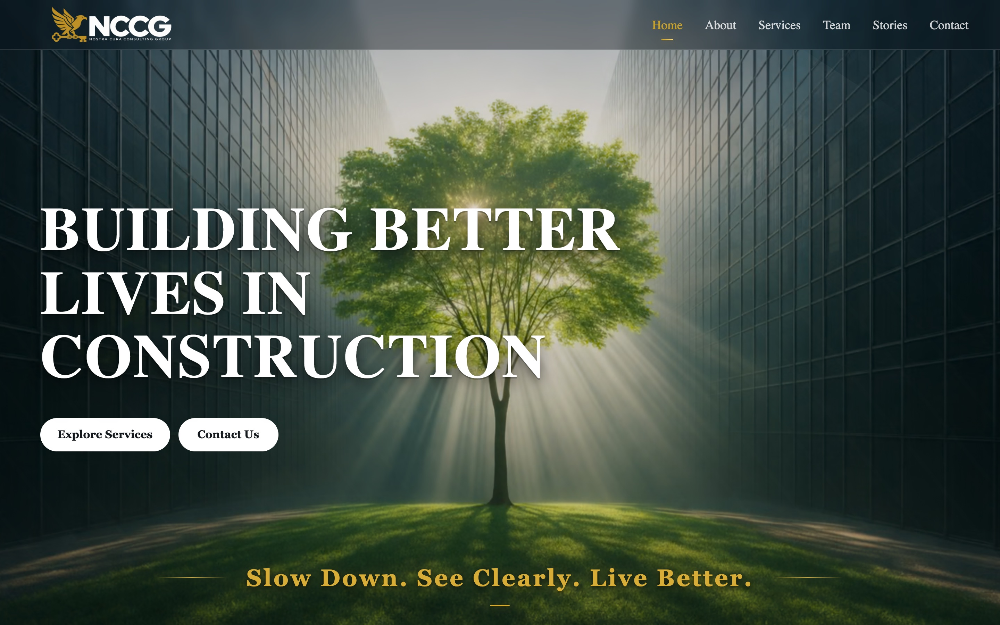
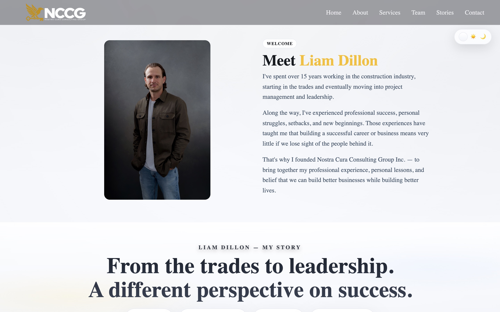

<div align="center">

# NCCG — Nostra Cura Consulting Group

**Brand website for a construction-industry wellbeing consultancy.**

[](https://nccg.ca/)


**[nccg.ca →](https://nccg.ca/)**



</div>

---

## Overview

Nostra Cura Consulting Group works with people in the construction industry on wellbeing and life outside the job site. The brief was a calm, premium site that reads like a story rather than a sales page: *"Slow Down. See Clearly. Live Better."*

The result is a single-page experience with smooth section navigation, a founder story page, a privacy policy, and two contact forms that deliver email through a serverless function instead of a third-party form service.

## Highlights

| | |
|---|---|
| **Prerendered for SEO** | A post-build prerender step writes static HTML for each route so content is crawlable without running JavaScript. |
| **Serverless contact delivery** | Forms post to a Netlify Function that sends through Resend. The recipient is chosen server-side, so no email address is exposed in the client. |
| **Abuse protection** | Origin check, honeypot field, idempotency keys for duplicate submissions and a platform rate limit of 5 requests per IP per minute. |
| **No secrets in the bundle** | API keys live only in Netlify Function environment variables, never in `VITE_*` variables. |
| **Considered UI details** | Readable Safari autofill colours, unified success state on desktop and mobile, accessible skip link, custom 404. |
| **Caching** | Content-hashed assets are cached for a year; HTML is revalidated on every visit. |

## Screenshots

<table>
  <tr>
    <td width="70%"></td>
    <td width="30%"></td>
  </tr>
</table>

## Site map

- **Home** — Hero, About, Services, Team, Your Stories and Contact sections with hash-based navigation
- **/liam** — founder story with its own contact form
- **/privacy** — privacy policy, linked from both forms and the footer

## Architecture

```
Browser ──► Netlify CDN (prerendered HTML + hashed assets)
   │
   └─► /.netlify/functions/contact
          ├─ validate input, origin, honeypot
          ├─ pick recipient server-side (main / founder)
          └─ Resend API ──► team inbox (visitor as Reply-To)
```

## Tech stack

- **Frontend:** React 19, TypeScript, React Router 7, Tailwind CSS 4, Framer Motion, React Hook Form
- **Backend:** Netlify Functions + Resend
- **Build:** Vite, custom prerender script, sitemap plugin
- **Quality:** ESLint, Node test runner (contact handler and SEO tests)

## Getting started

```bash
npm install
npm run dev     # local dev server
npm run build   # type-check, build, prerender
npm test        # contact and SEO tests
```

Contact delivery needs `RESEND_API_KEY` and `CONTACT_FROM_EMAIL` set in Netlify (Functions scope). See [docs/CONTACT-DELIVERY.md](docs/CONTACT-DELIVERY.md).

## Project structure

```
src/
  sections/   home page sections (Hero, About, Services, Team, Stories, Contact)
  pages/      founder story, privacy policy, 404
  components/ layout, SEO, carousel, error boundary
netlify/functions/contact.mjs   email delivery
scripts/prerender.mjs           static HTML generation
tests/                          automated tests
docs/                           SEO audit and delivery notes
```

---

<div align="center">

Designed and built by [@Martikk](https://github.com/Martikk) · Live at **[nccg.ca](https://nccg.ca/)**

</div>
